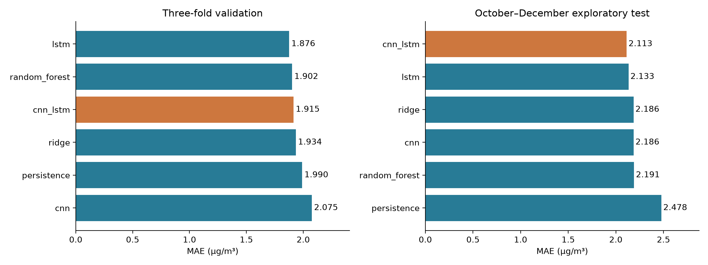
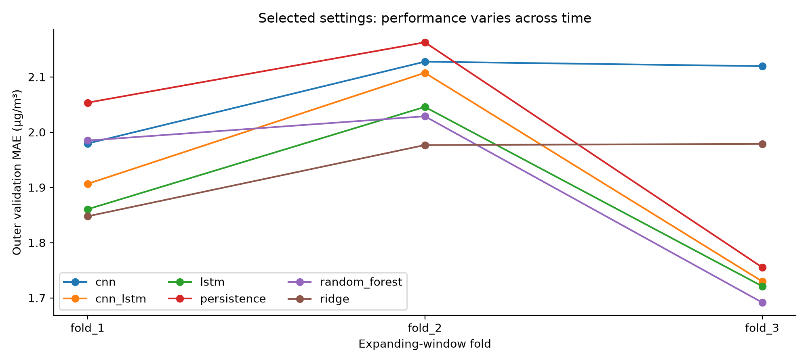

# PM2.5 Forecasting Across Alabama Counties

Shyam Prasad Kuikel

This research project examines when statistical, machine-learning and neural-network models improve next-day PM2.5 forecasts over persistence, and whether those improvements hold across ten Alabama monitoring series and high-pollution days. It uses daily 2025 observations and includes exploratory meteorological analysis, PCA, reproducible model comparisons and saved results.

The county names identify monitoring series; the observations do not represent county-wide exposure estimates. This is an exploratory research project, not an operational forecasting service.

## Start with the current study

- [Methods, data preparation and reproduction instructions](Ana_SK/pooled_county_study/README.md)
- [Results and scientific limitations](Ana_SK/pooled_county_study/STUDY_RESULTS_AND_CONCLUSIONS.md)
- [Concise study report PDF](Ana_SK/pooled_county_study/PM25_Pooled_County_Study_Summary.pdf)
- [Verification performed for this repository](VERIFICATION.md)

## Study area


[Map sources and limitations](Ana_SK/initial_study/study_area_map/README.md).

## Experiment

The current pooled experiment compares persistence, ridge regression, Random Forest, CNN, LSTM and CNN-LSTM. Training and tuning use chronological expanding-window validation within January–September 2025. October–December provides the exploratory evaluation period. Input imputation and scaling are fitted on training periods, and all models are compared on the same 887 evaluation cases.

The evaluation months had already been examined in earlier analyses. Consequently, these results are exploratory rather than an untouched confirmatory test. The supplied study documentation explains the tuning design, seed averaging, preprocessing and remaining data-provenance limitations.

## Saved results

| Model | MAE | RMSE | R squared | MAE on high-pollution days |
| --- | ---: | ---: | ---: | ---: |
| CNN-LSTM | 2.113 | 2.734 | 0.355 | 4.435 |
| LSTM | 2.133 | 2.750 | 0.347 | 4.448 |
| Ridge | 2.186 | 2.823 | 0.312 | 4.312 |
| CNN | 2.186 | 2.870 | 0.289 | 3.872 |
| Random Forest | 2.191 | 2.808 | 0.319 | 4.370 |
| Persistence | 2.478 | 3.299 | 0.060 | 3.674 |

MAE and RMSE are in micrograms per cubic metre. The high-pollution subset contains 27 cases under the study's specified threshold. CNN-LSTM had the lowest aggregate evaluation MAE, but the paired uncertainty interval for its advantage over LSTM crossed zero. Persistence performed better than the learned models on the high-pollution subset. Better average performance therefore does not establish better episode prediction.





[Full metrics](Ana_SK/pooled_county_study/results/pooled_test_metrics.csv) and [paired model comparisons](Ana_SK/pooled_county_study/results/paired_mae_intervals.csv).

## Reproduce the current study

Python 3.12 and a CPU are sufficient; Apple MPS acceleration is optional. Historical runs were performed on Apple Silicon. Consult VERIFICATION.md for what was rerun in the present environment.

```sh
git clone https://github.com/shyamkuikel/Alabama-PM25-Modeling.git
cd Alabama-PM25-Modeling/Ana_SK/pooled_county_study
python3 -m venv .venv
source .venv/bin/activate
python -m pip install --upgrade pip
python -m pip install -r requirements.txt
python -m unittest -v test_pipeline.py
python verify_results.py
```

To train again without overwriting the supplied results:

```sh
python run_study.py --data data/merged_counties.xlsx --device cpu --output results_new
python verify_results.py --data data/merged_counties.xlsx --results results_new
```

## Project contents

| Folder | Contents |
| --- | --- |
| [Ana_SK/pooled_county_study](Ana_SK/pooled_county_study) | Current forecasting pipeline, data, models and results |
| [Ana_SK](Ana_SK/README.md) | Python meteorological PCA screening |
| [R_PCA](R_PCA/README.md) | R PCA and component–PM2.5 association workflow |
| [Ana_SK/initial_study](Ana_SK/initial_study/README.md) | Earlier exploratory analyses and forecasting experiments |
| [Source verification](Ana_SK/initial_study/07_prediction/model_comparison/source_verification/SOURCE_FINDINGS.md) | PM2.5 matching, weather investigation and provenance limits |

Earlier workflows remain available for context. Their results use different preprocessing or experimental designs and should not be compared as if they were identical experiments. The large source-weather CSV is stored losslessly as `weather_2025.csv.gz`; its source-verification script reads it directly.

## Research limitations

Only one year is available. Shared weather series and dependence among monitoring locations limit independent information. Source reporting delays and parts of the weather provenance remain unresolved. A new, previously untouched year is needed to assess temporal generalization. The analyses describe predictive performance and associations, not causal meteorological effects.

## Data and software attribution

External measurement data, map boundaries, publications and software retain their original attribution. Source information is documented in the analysis folders. No new license is asserted over third-party datasets. This repository is maintained by Shyam Prasad Kuikel.
